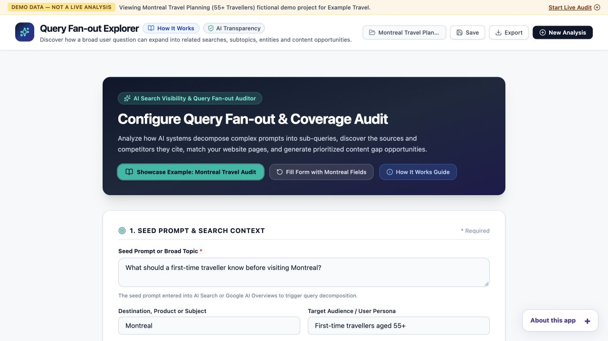

# Query Fan-out Explorer

Study how related searches and source coverage vary across repeated AI-assisted research runs.

Built by [Ami Saeednia](https://www.seogirl.ca), SEO / GEO Strategist.

[Live app](https://seogirl-query-fanout-ai-coverage-auditor.vercel.app/) · [Research and studies](https://www.seogirl.ca/research/same-question-different-searches) · [All tools](https://www.seogirl.ca/apps)

## The problem

Study how related searches and source coverage vary across repeated AI-assisted research runs.

## Who it is for

Search researchers and content teams comparing query coverage, follow-ups and citations.

## Workflow and methodology

Define a topic and site, review the explicitly labelled demo, then compare repeated provider runs and coverage evidence. Keep run settings and captured metadata together so differences can be interpreted.

## Evidence and limitations

The default Montreal travel example is fictional. Provider-returned searches are observable metadata, not access to hidden reasoning or a reconstruction of Google AI Mode. Runs vary with provider, model, settings and time; missing metadata is not evidence that no search happened.

The screenshot documents the interface, not an independently validated result. This repository is a practical research tool; its outputs require human review.

## Local setup

Use the repository root: `npm install`, `npm run dev`, `npm run lint`, and `npm run build`. The frontend uses the endpoint configured in `src/config.ts` (`QUERY_FANOUT_PROXY_URL`). Live analysis needs a compatible deployed backend; setting a Gemini key in the browser alone does not configure that backend. Keep provider credentials server-side. Check the configured backend and its data handling before using confidential inputs.

Review `package.json` for the exact scripts and dependencies. Do not put secrets in frontend code or commit local environment files.

## Background

I build tools to make entity strategy, technical SEO and AI-search research easier to inspect and apply. Explore my [independent studies](https://www.seogirl.ca/research), [workbooks](https://www.seogirl.ca/workbooks) and [project case studies](https://www.seogirl.ca/case-studies).
